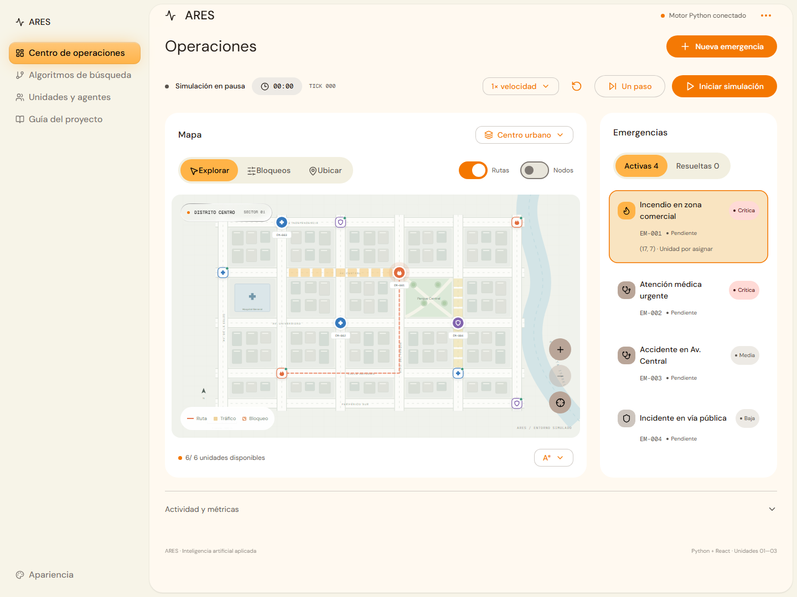

# ARES · Sistema Multiagente Inteligente para la Gestión de Emergencias

Proyecto académico de Inteligencia Artificial que integra fundamentos de IA, agentes racionales y búsqueda de rutas. Motor en **Python**, API con **FastAPI** e interfaz **React + TypeScript**, con **@yewdiel21/motion-kit y GSAP**.



## Iniciar en Windows

Requisitos: **Python 3.11+** y, para instalar o recompilar el frontend, **Node.js 22.12+** (también funciona 20.19+). La primera instalación requiere internet.

Haz doble clic en `start.bat` o ejecuta desde esta carpeta:

```powershell
.\start.ps1
```

Si la política de PowerShell impide abrir el script:

```powershell
powershell -NoProfile -ExecutionPolicy Bypass -File .\start.ps1
```

El iniciador prepara un entorno virtual local, instala las versiones de Python verificadas, compila React si falta `frontend/dist` e inicia la aplicación:

- Interfaz: <http://127.0.0.1:8000>
- Documentación interactiva de la API: <http://127.0.0.1:8000/docs>
- Detener: `Ctrl+C` en la terminal.
- Otro puerto: `.\start.ps1 -Port 8080`.
- Sin abrir navegador: `.\start.ps1 -NoBrowser`.

La entrega incluye el frontend compilado. Tras modificar el código React, ejecuta `npm run build` dentro de `frontend` para actualizarlo.

## Desarrollo con recarga automática

Desde la raíz del proyecto, primera vez:

```powershell
python -m venv .venv
.\.venv\Scripts\python.exe -m pip install -r requirements-lock.txt
```

Terminal 1:

```powershell
.\.venv\Scripts\python.exe -m uvicorn backend.main:app --reload --host 127.0.0.1 --port 8000
```

Terminal 2:

```powershell
cd frontend
npm ci
npm run dev
```

Abre <http://127.0.0.1:5173>. Vite redirige `/api` a Python. En Linux/macOS, crea el entorno con `python3 -m venv .venv` y sustituye `.venv\Scripts\python.exe` por `.venv/bin/python`.

## Funcionalidades

- Mapa urbano SVG de 30 × 23 celdas; cada movimiento representa 100 metros.
- Seis unidades: dos ambulancias, dos unidades de bomberos y dos patrullas.
- Coordinador que asigna por especialidad, prioridad con envejecimiento y costo de ruta.
- BFS, DFS, Dijkstra y A* implementados en Python mediante Strategy.
- Inicio, pausa, avance de un paso y velocidades 1×, 2× y 4×.
- Emergencias nuevas en una ubicación automática o elegida sobre una calle.
- Bloqueos editables y planificación dinámica ante cambios.
- Tres escenarios reproducibles: centro urbano, hora pico y vías bloqueadas.
- Comparación de pasos, costo, nodos expandidos y tiempo real de cómputo; exportación CSV.
- Interfaz centrada en mapa y emergencias, con bitácora, métricas y detalles de agentes desplegables.
- Comparación en una sola tabla; selección de emergencia con `Menu` de Motion Kit y explicaciones bajo demanda.
- Guía académica con fundamentos de IA y modelo PEAS en secciones plegables.
- Interfaz adaptable, tema claro/oscuro y movimiento reducido.

## Estructura y patrones

```text
backend/
  domain/             # Entidades Agent/Incident y grafo Grid
  algorithms/         # Contrato SearchStrategy y cuatro estrategias
  application/        # Simulation y política pura Coordinator
  infrastructure/     # Factoría determinista de escenarios
  api/                # Schemas Pydantic, rutas y dependencias
  main.py             # create_app: composition root y frontend estático
frontend/
  src/
    components/       # Mapa, incidentes, comparación, formularios y Disclosure
    pages/            # Operations, Algorithms, Agents y Guide
    hooks/            # useSimulation y useRouteMotion
    services/         # Cliente HTTP y notificaciones
    config/           # Metadatos de algoritmos
    types.ts          # Contratos TypeScript
    styles.css        # Composición y elementos propios del simulador
    map.css           # Representación gráfica del entorno urbano
  tests/e2e/          # Flujos reales de navegador con Playwright
tests/                # Pruebas de algoritmos, simulación y API
scripts/benchmark.py  # 48 comparaciones con mediana de 25 repeticiones
docs/                 # Arquitectura, memoria, demostración y evidencia
```

Los patrones empleados están explicados en [Arquitectura](docs/ARQUITECTURA.md). Las reglas de búsqueda y coordinación no dependen de React ni de FastAPI. Cada instancia de la API recibe su propio contenedor de simulación, lo que permite pruebas aisladas.

## Motion Kit

Instalados `@yewdiel21/motion-kit` **0.9.1** y GSAP **3.15.0**, fijados mediante `package-lock.json`. Integración basada en la skill y documentación incluidas en el paquete:

- `Nav` dentro de `.mk-shell`: navegación original del kit, con sus siete estilos y barra de cristal en móvil.
- `Menu.Root/Trigger/Content/Item/Separator`: emergencia a comparar, escenarios, velocidad, planificador y opciones del escenario, con teclado y retorno del foco.
- `Dialog.Root/Trigger/Content/Header/Title/Body/Footer/Close`: registro de emergencias, reinicio y apariencia, conservando formas y transiciones originales.
- `Steps`, `Steps.Step` y `Steps.Counter`: registro en tres etapas, con validación, regreso y revisión antes de enviar a Python.
- `Toaster` y `toast`: avisos y errores de la API.
- `AnimatedNumber`: conteos de emergencias y unidades disponibles.
- `FlipGroup`: actualización de la lista de emergencias.
- `useCascade`: entrada de cabecera.
- `useDetails`: bitácora y métricas, explicaciones de algoritmos, detalles de agentes y guía, plegados de inicio.
- `ThemeProvider`, `ThemePicker` y `useTheme`: seis paletas seleccionables, modo claro/oscuro/sistema y persistencia.
- `useTabs` y `.mk-segmented`: herramientas del mapa y filtros, con indicador animado y navegación por teclado.
- `.mk-button`, `.mk-field`, `.mk-switch`, `.mk-chip` y `.mk-glass`: controles y superficies nativos del kit.
- GSAP `matchMedia`: dirección animada sobre rutas activas, con limpieza al desmontar.

No se modificó código de `node_modules`. Se eliminó el armazón visual anterior: el kit proporciona navegación, controles, tipografía, radios, paletas y transiciones. `src/styles.css` compone el contenido y los elementos propios del simulador. No sustituye la apariencia de los componentes del kit. Consulta el [mapa de componentes](docs/COMPONENTES.md). El kit y el código GSAP adicional respetan `prefers-reduced-motion`.

## Verificación

Python, desde la raíz:

```powershell
.\.venv\Scripts\python.exe -m unittest discover -s tests -v
```

React y pruebas de navegador:

```powershell
cd frontend
npm run build
npx playwright install chromium
npm run test:e2e
```

Playwright inicia Python si no hay un servidor en el puerto 8000. **Las pruebas reinician el entorno compartido**, por lo que conviene ejecutarlas fuera de una demostración.

Evidencia generada: **23 pruebas Python y 14 pruebas de navegador aprobadas**, más compilación TypeScript/Vite. Consulta [Pruebas y resultados](docs/PRUEBAS.md).

Repetir el experimento de algoritmos:

```powershell
.\.venv\Scripts\python.exe -m scripts.benchmark
```

Genera [docs/comparacion.csv](docs/comparacion.csv). Los caminos y costos son deterministas; las mediciones de tiempo dependen del equipo y la carga.

## Material para la entrega

- [Memoria técnica y unidades 1–3](docs/MEMORIA.md).
- [Arquitectura y patrones de diseño](docs/ARQUITECTURA.md).
- [Guion de demostración](docs/DEMOSTRACION.md).
- [Pruebas y resultados](docs/PRUEBAS.md).
- [Resultados CSV](docs/comparacion.csv).

## Alcance

Simulación académica local, de un solo proceso y un escenario compartido. El estado vive en memoria y se pierde al reiniciar Python. Las unidades se quedan disponibles en la última ubicación al completar la atención. No se modelan colisiones, combustible, transporte a hospitales, usuarios concurrentes independientes ni datos de emergencias reales. El coordinador aplica una política voraz; no garantiza la asignación global óptima de toda la flota. Iniciar/pausar y la frecuencia de los ticks se controlan desde el navegador.

## Referencias

- [FastAPI: pruebas de aplicaciones](https://fastapi.tiangolo.com/tutorial/testing/).
- [Vite: guía oficial](https://vite.dev/guide/).
- [Motion Kit: repositorio y documentación](https://github.com/YewdielMartinez/motion-kit).
- [GSAP: integración con React](https://gsap.com/resources/React/).
