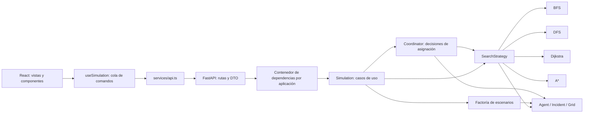
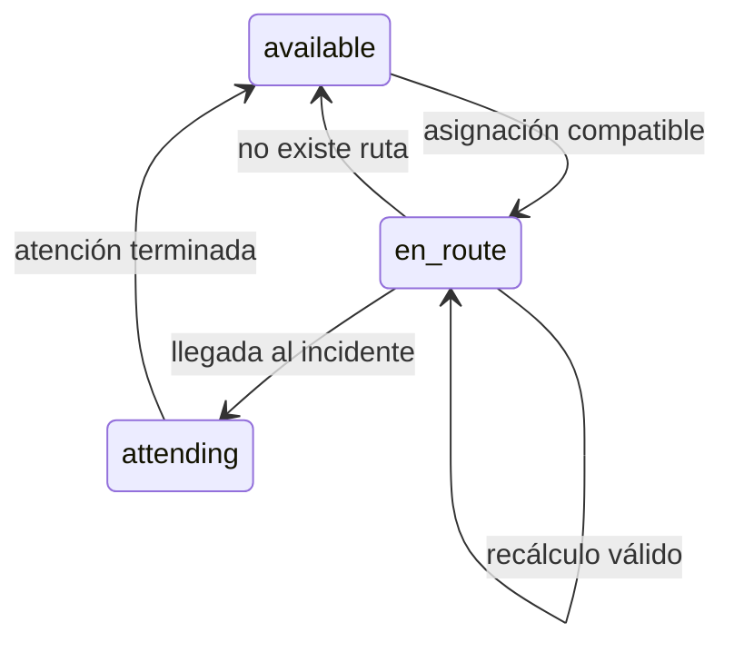
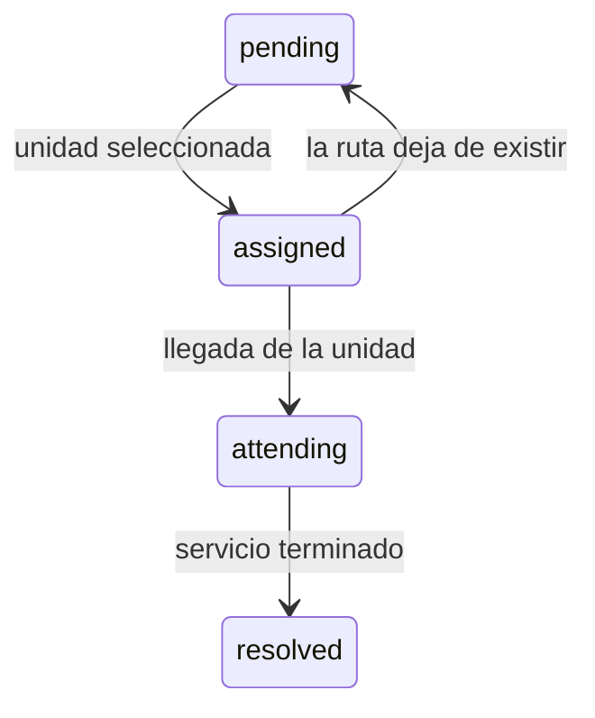

# Arquitectura y patrones

ARES utiliza separación por responsabilidades. El motor se puede ejecutar y probar sin navegador; React consume contratos HTTP y no replica los algoritmos.



## Responsabilidades de Python

| Módulo | Responsabilidad | Dependencias principales |
|---|---|---|
| `domain/grid.py` | Grafo transitable, vecinos, obstáculos y costo de entrada | Biblioteca estándar |
| `domain/models.py` | Estado de unidades e incidentes con dataclasses | Dominio |
| `algorithms/search.py` | Búsqueda, reconstrucción de rutas e instrumentación | Grid y biblioteca estándar |
| `application/coordinator.py` | Producir asignaciones sin modificar las entidades recibidas | Dominio y búsqueda |
| `application/simulation.py` | Aplicar decisiones, avanzar ticks, atender y recalcular | Coordinador, dominio, búsquedas y factoría |
| `infrastructure/scenarios.py` | Construir mapas y costos repetibles | Grid |
| `api/schemas.py` | Validar la frontera HTTP mediante Pydantic | Pydantic |
| `api/routes.py` | Traducir solicitudes en llamadas de aplicación y errores HTTP | Aplicación y dependencias |
| `api/dependencies.py` | Proveer simulación y lock desde `app.state` | FastAPI y aplicación |
| `main.py` | Ensamblar la aplicación e incorporar React compilado | FastAPI y capas anteriores |

La carpeta `infrastructure` contiene configuración reproducible, sin red ni persistencia. No se añade Repository porque el proyecto no necesita guardar entidades en una base de datos.

## Patrones empleados

### Strategy: algoritmos intercambiables

`SearchStrategy` define `explore(grid, start, goal)`. Las clases `BreadthFirstStrategy`, `DepthFirstStrategy`, `DijkstraStrategy` y `AStarStrategy` cumplen ese contrato. Un registro selecciona la estrategia por nombre; `search()` concentra validación del nombre, reconstrucción de camino, cálculo de costo y medición.

Las estrategias no conservan estado entre invocaciones. Dijkstra y A* comparten el manejo de la cola de prioridad; A* redefine la heurística. BFS y DFS comparten la visita de vecinos y cambian la extracción FIFO/LIFO. Agregar una estrategia consiste en implementarla y registrarla; también deben actualizarse el contrato de entrada HTTP y los metadatos React que enumeran los algoritmos admitidos.

### Composition Root e inyección de dependencias

`create_app(simulation=None)` construye el contenedor de cada aplicación. `get_container` obtiene ese contenedor a través de `Depends`. No existe un singleton de simulación compartido entre aplicaciones de prueba. Para sustituir el entorno:

```python
from backend.application.simulation import Simulation
from backend.main import create_app

app = create_app(Simulation(scenario='traffic', seed=42))
```

El lock reentrante serializa las modificaciones y las lecturas completas de una instantánea. Se requiere un único proceso Uvicorn: varios workers crearían memorias distintas.

### Política pura y aplicación de decisiones

El coordinador devuelve objetos inmutables `Assignment` con unidad, incidente, camino y costo. Reserva identificadores localmente para impedir asignaciones duplicadas durante el mismo lote. `Simulation.dispatch()` aplica las decisiones y registra los eventos. Separar elección y mutación permite probar la racionalidad sin avanzar el reloj.

### Máquina de estados explícita

Los estados son campos de entidades; las transiciones se centralizan en `Simulation`. Se usa una máquina de estados sencilla, sin crear una clase por cada estado.





### Pizarra compartida

Agentes y coordinador observan la misma representación del entorno. La cooperación se realiza mediante `Simulation`, que mantiene misiones y disponibilidad, y no mediante procesos de red. Las unidades no compiten por una emergencia ya asignada.

## Responsabilidades de React

`App` compone el armazón `.mk-shell` con `Nav`, las métricas y el diálogo compartido. Las páginas se responsabilizan de su presentación; los componentes reutilizables no emiten solicitudes HTTP directamente.

- `useSimulation`: conecta la API, solicita comparaciones y administra el temporizador. Las mutaciones pasan por una cola de promesas, conservando el orden entre pasos, bloqueos y reinicios. Pausar permite completar una solicitud ya enviada.
- `services/api.ts`: concentra fetch, JSON y traducción de errores; los contratos se describen en `types.ts`.
- `Operations`: estado visual del mapa, herramientas, filtros y controles del reloj.
- `CityMap`: representa exactamente las calles, costos, bloqueos y posiciones que entrega Python. La animación no modifica coordenadas lógicas.
- `ComparisonPanel`: tabla de resultados en Algoritmos; cada fila permite activar una estrategia.
- `Disclosure`: composición de la receta `useDetails` de Motion Kit para información secundaria, métricas y contenido académico.
- `services/notifications.ts`: adapta las notificaciones a Motion Kit, sin acoplar el cliente HTTP al DOM.

## Motion Kit y GSAP

Se siguió `node_modules/@yewdiel21/motion-kit/skills/motion-kit/SKILL.md`, más sus referencias de diseño y componentes.

La integración usa **componentes compuestos** para los diálogos: `Dialog.Root` comparte estado, `Trigger` conserva el origen y `Content/Header/Title/Body/Footer/Close` representan las partes. El kit administra el foco nativo, Escape, backdrop, apertura morph y limpieza del motor. React controla si el diálogo muestra el formulario o el reinicio. Se conserva el radio y la presentación originales, incluidos los diálogos de pantalla completa en móvil.

`Nav` usa Dock como único estilo, con su barra de cristal nativa en móvil. El diálogo de apariencia permite personalizar la paleta y el modo de pantalla. `ThemeProvider` establece OLED oscuro por defecto; `ThemePicker` ofrece seis paletas y `useTheme` conmuta claro/oscuro/sistema. Las preferencias de tema guardadas se respetan mediante el runtime del kit. El HTML y el script de tema comparten los valores iniciales para aplicarlos antes del montaje. Los scripts de tema y seguridad de entradas se insertan en el HTML desde Vite.

`KitControls.tsx` contiene adaptadores controlados de los componentes originales: `SelectMenu` compone `Menu`, `SegmentedControl` conecta `useTabs` y `ControlSwitch` usa `.mk-switch`. No implementan motores de animación alternativos. Los campos y botones usan `.mk-field` y `.mk-button` con sus variantes originales.

`Steps` divide el formulario en incidente, prioridad y confirmación. La aplicación distingue el paso solicitado del paso confirmado por el motor del kit, impidiendo que un callback atrasado revierta un clic nuevo. Los botones de avance esperan la confirmación del cambio. El primer campo permanece enfocable mientras se animan las piezas de texto.

`styles.css` se limita a distribución y elementos propios del simulador; `map.css` define la representación urbana. Se retiraron la barra lateral manual y los controles visuales duplicados. Para preservar el retorno del foco de `Menu`, sus disparadores pendientes usan `aria-disabled` con prevención de activación, en lugar de perder el foco mediante `disabled` nativo.

`AnimatedNumber` interpola métricas, `FlipGroup` mide antes de actualizar listas y `useCascade` gestiona las entradas. `useRouteMotion` añade desplazamiento de trazos GSAP, restringido al SVG del componente y a `prefers-reduced-motion: no-preference`; `matchMedia.revert()` limpia al cambiar de vista o de preferencia. No hay efectos WebGL ni animaciones que retrasen una decisión del motor.

## Contratos HTTP

| Método y ruta | Función |
|---|---|
| `GET /api/health` | Estado del servicio |
| `GET /api/state` | Instantánea de mapa, unidades, incidentes, métricas y bitácora |
| `POST /api/reset` | Nuevo escenario y semilla |
| `POST /api/step` | De 1 a 100 pasos por solicitud |
| `POST /api/dispatch` | Asignar sin avanzar el reloj |
| `POST /api/algorithm` | Cambiar estrategia y recalcular rutas activas |
| `POST /api/incidents` | Registrar tipo, gravedad y ubicación opcional |
| `POST /api/obstacles` | Alternar bloqueo de una calle libre |
| `GET /api/compare` | Comparar las cuatro estrategias; admite `incident_id` y `agent_id` |

Errores de validación: 422. Coordenadas no transitables, duplicadas u ocupadas: 400. Emergencia o agente inexistente en comparaciones: 404. El esquema completo está disponible en `/docs` y `/openapi.json`.
